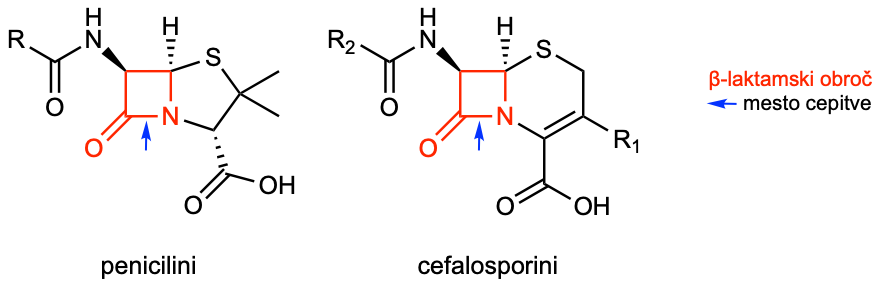
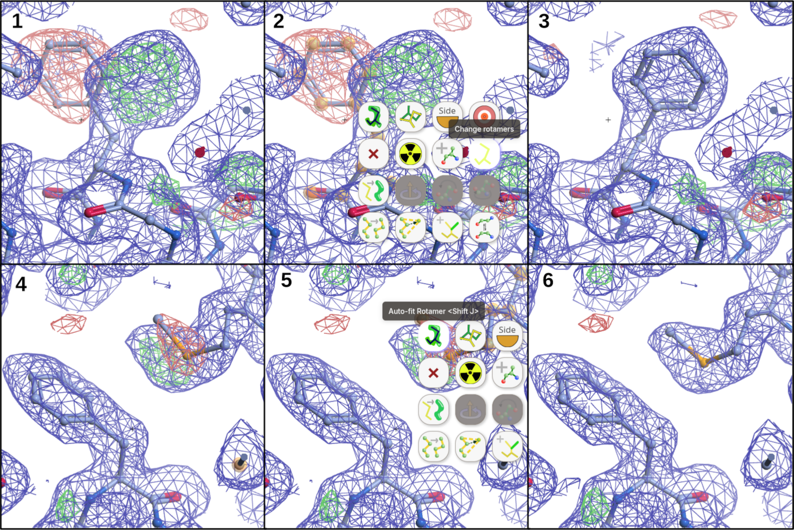

# Gradnja modela strukture z uporabo elektronske gostote

## Namen

Namen delavnice je spoznati osnove ročne gradnje in piljenja modela strukture proteina z uporabo eksperimentalnih podatkov, v konkretnem primeru gre za elektronsko gostoto, izračunano iz difrakcijskih podatkov (makromolekulska X-žarkovna kristalografija), podobni principi pa veljajo tudi v primeru elektronske difrakcije in krio-elektronske mikroskopije.

Pri delu bomo uporabljali program [Moorhen](https://moorhen.org/), ki predstavlja spletno različico programa [COOT](https://www2.mrc-lmb.cam.ac.uk/personal/pemsley/coot/) (Crystallographic Object-Oriented Toolkit), danes najpogosteje uporabljanega programa za gradnjo, piljenje in validacijo modelov struktur makromolekul {cite:p}`Emsley2010aaa`. Isti program se lahko uporablja tako za gradnjo modelov struktur na osnovi podatkov, pridobljenih z difrakcijo (rentgenska, elektronska difrakcija), kot tudi s krio-elektronsko mikroskopijo.

## Vaša naloga

- Z uporabo Morheen dogradite in izboljšajte model strukture $\beta$-laktamaze KPC-2 z vezanim inhibitorjem avibaktamom, pri tem pa uporabite karto elektronske gostote, izračunano na osnovi difrakcijskih podatkov (ločljivost 1,8 Å).
    - 'Dogradite' pomeni, da v trenutnem modelu strukure nekateri deli (aminokislinski ostanki, ligandi, ...) manjkajo in jih morate dodati, 'izboljšajte' pa, da prilagodite koordinate dodatnih ter v modelu že prisotnih atomov/ostankov tako, da bodo kar se da skladni z eksperimentalnimi podatki (elektronska gostota) kot tudi stereokemijskimi parametri (Ramachandranov diagram, dolžine vezi, koti med vezmi, rotameri itd.) in bo končen model imel tudi kemijski smisel.
- Na koncu vaš dograjen in izboljšan model primerjajte z izpiljenim modelom strukture, deponiranim v zbirko PDB.

## Postavimo protein v kontekst (nekaj o KPC-2)

### Splošno o $\beta$-laktamazah

$\beta$-laktamaze so bakterijski encimi, ki s hidrolizo odprejo $\beta$-laktamski obroč antibiotikov in jih tako inaktivirajo. S tem preprečijo, da bi antibiotiki zavirali sintezo bakterijske celične stene, zato so pomemben vzrok odpornosti proti penicilinom, cefalosporinom in drugim $\beta$-laktamskim antibiotikom (več: [Betalaktamski_antibiotik @ Wikipedia](https://sl.wikipedia.org/wiki/Betalaktamski_antibiotik)).



Po Amblerjevi klasifikaciji jih delimo v štiri razrede, A, B, C in D: razredi A, C in D imajo v aktivnem mestu katalitični serin, razred B pa obsega metalo-$\beta$-laktamaze, ki za delovanje potrebujejo cinkove ione. Med značilne predstavnike sodijo encimi TEM, SHV, CTX-M in KPC v razredu A, NDM, VIM in IMP v razredu B, AmpC v razredu C ter encimi OXA v razredu D. Posebej problematične so $\beta$-laktamaze razširjenega spektra (*Extended-Spectrum Beta-Lactamases*, ESBL) in karbapenemaze, saj zmanjšujejo izbor učinkovitih antibiotikov, njihovi geni pa se lahko med bakterijami širijo s plazmidi.

Njihovo delovanje lahko obidemo s kombiniranjem $\beta$-laktamskega antibiotika z zaviralcem (inhibitorjem) $\beta$-laktamaz, ki antibiotik zaščiti pred encimsko razgradnjo. Klasični primeri so **amoksicilin s klavulansko kislino, ampicilin s sulbaktamom in piperacilin s tazobaktamom**, pri čemer ti zaviralci delujejo predvsem proti številnim encimom razreda A. Novejše kombinacije vključujejo **ceftazidim z avibaktamom, meropenem z vaborbaktamom in imipenem z relebaktamom**, ki omogočajo zaščito tudi pred nekaterimi $\beta$-laktamazami, odpornimi proti starejšim zaviralcem. Avibaktam zavira številne encime razredov A in C ter nekatere razreda D, vaborbaktam in relebaktam pa predvsem encime razredov A in C; nobeden od teh treh zaviralcev ne zavira metalo-$\beta$-laktamaz razreda B. Pri bakterijah z metalo-$\beta$-laktamazami je uporabna kombinacija **aztreonama z avibaktamom**, saj je aztreonam praviloma odporen proti hidrolizi s temi encimi, avibaktam pa ga zaščiti pred drugimi $\beta$-laktamazami, ki jih bakterija lahko proizvaja hkrati.

### KPC-2

KPC-2 (*Klebsiella pneumoniae* karbapenemaza tipa 2) je serinska $\beta$-laktamaza razreda A, ki hidrolizira številne $\beta$-laktamske antibiotike, vključno s karbapenemi, in tako bakterijam omogoča odpornost tudi proti tem pomembnim zdravilom. **Avibaktam jo zavira tako, da s katalitičnim serinom v njenem aktivnem mestu tvori reverzibilno kovalentno vez in prepreči razgradnjo antibiotika.** Kombinacija ceftazidima z avibaktamom je pomembna možnost zdravljenja okužb z bakterijami, ki proizvajajo KPC-2, saj hkratna administracija omogoča učinkovito delovanje ceftazidima. Težavo lahko predstavljajo mutacije KPC-2, ki zmanjšajo občutljivost za avibaktam in povzročijo odpornost tudi proti tej kombinaciji. Razumevanje podrobnosti vezave avibaktama na KPC-2 je tako pomembno z vidika načrtovanja novih tovrstnih inhibitorjev.

## Vhodni podatki

### Protein

Gre za encim KPC-2 iz *Klebsiella pneumoniae* (UniProt [Q9F663](https://www.uniprot.org/uniprotkb/Q9F663)), rekombinantno pripravljen v **Escherichia coli**. Za izražanje je bila uporabljena nekoliko skrajšana oblika proteina z naslednjim aminokislinskim zaporedjem:

```text
TNLVAEPFAKLEQDFGGSIGVYAMDTGSGATVSYRAEERFPLCSSFKGFLAAAVLARSQQ
QAGLLDTPIRYGKNALVPWSPISEKYLTTGMTVAELSAAAVQYSDNAAANLLLKELGGPA
GLTAFMRSIGDTTFRLDRWELELNSAIPGDARDTSSPRAVTESLQKLTLGSALAAPQRQQ
FVDWLKGNTTGNHRIRAAVPADWAVGDKTGTCGVYGTANDYAVVWPTGRAPIVLAVYTRA
PNKDDKHSEAVIAAAARLALEGLG
```

### Kristalizacija in ligand

Protein je bil kristaliziran z uporabo metode z difuzijo vodne pare na način sedeče kapljice, raztopina rezervoarja je imela naslednjo sestavo: 20 % (w/v) PEG 6000, 100 mM kalijev tiocianat, 100 mM citrat pH 4,0. Dobljeni kristali so bili inkubirani 8 min v raztopini avibaktama (koncentracija 5 mM) v nekoliko spremenjeni matični raztopini (25 % PEG 6000, 100 mM citrat pH 5.0, 20 % etilen glikol), nato pa zamrznjeni v tekočem dušiku.

Kemijsko ime za avibaktam je (2S,5R)-1-formil-5-[(sulfooksi)amino]piperidin-2-karboksamid, najdemo ga v zbirki ligandov na RCSB PDB (koda [NXL](https://www.rcsb.org/ligand/NXL)).

<iframe src="https://molstar.org/viewer/?snapshot-url=https://raw.githubusercontent.com/mpavsic/sbio/main/sbio/vaje/seje/avibaktam-NXL.molx&snapshot-url-type=molx&hide-controls=1" style="width: 100%; height: 500px; border: 0px"></iframe>

(difrakcijski-podatki)=
### Difrakcijski podatki in začetni model

Difrakcijski podatki so bili posneti pod krio-pogoji, sprocesirani (prostorska skupina $P 2_1 2_1 2_1$), za faziranje z molekulsko zamenjavo ([*molecular replacement*](https://en.wikipedia.org/wiki/Molecular_replacement)) pa je bila uporabljena znana (eksperimentalno določena) struktura podobne $\beta$-laktamaze. Po molekulski zamenjavi je bil ta začetni model uporabljen za začetno gradnjo modela strukture KPC-2. V asimetrični enoti je ena molekula proteina, KPC-2 pa je sicer znan kot monomeren protein.

- Datoteka z elektronsko gostoto (karti $2F_o – F_c$ in $F_o – F_c$): [KPC2avi.mtz](datoteke/KPC2avi.mtz)
- Datoteka z delno zgrajenim modelom strukture: [KPC2avi.pdb](datoteke/KPC2avi.pdb)

## Potek vaje

1. Pojdite na spletno stran [Moorhen.org](https://moorhen.org/).
2. Naložite PDB (koordinate) in MTZ datoteki (strukturni faktorji, karte elektronske gostote) (`"hamburger menu" > File > Open Files`), [prenešeni s te spletne strani](difrakcijski-podatki).
   - Datoteki lahko naložite hkrati (obe označite pri odpiranju) ali pa eno za drugo.
3. Oglejte si, kako se elektronska gostota nadaljuje "v neskončnost".
4. Omogočite izračun R-faktorja in osveževanje kart elektronske gostote tako, da naložene karte in podatke povežete s strukturo: `File > Connect Molecule and Maps... > Ok`
5. Spremenite prikaz proteina iz načina 'Ribbons' v 'Bonds' (sicer ne vidite posameznih ostankov): `Models` >  ikona svinčnika...
6. Vklopite prikaz atomov iz sosednjih asimetričnih enot: `Models > (zobnik) > Cell and Symmetry > Show symmetry mates`.
7. Nastavite nivo konturiranja diferenčne karte elektronske gostote ($F_o – F_c$) na pribl. RMSD 3,4–3,5: `Maps`, uporabite drsnik pri karti KPC2avi.-map-1.
8. Z orodji, ki jih najdete pod `Validation`, analizirajte ujemanje modela strukture z elektronsko gostoto in stereokemijskimi parametri, na primer:
   - `Difference Map Peaks...` vam pokaže, kje v strukturi nekaj manjka (zeleno obarvana diferenčna karta el. gostote) oz. je tam, kjer ne bi smelo biti (rdeče obarvana diferenčna karta el. gostote)),
   - `Ramachandran Plot...` vam pokaže, kateri ostanki so izven favoriziranih in dovoljenih območij kombinacij dihedralnih kotov glavne verige,
   - `Unmodelled Blobs...` vam poišče "oblačke" elektronske gostote, ki niso zapolnjeni z atomi (torej v modelu strukuture tam nekaj manjka),
   - idr.
   - Nekaj napak v strukturi vam razkrije že vklop "Ramachandran Balls" in "Contact Dots" (s slednjim lahko identificirate atome, ki sicer niso kovalentno povezavi, so si pa preblizu): `Models > Tools > (različne možnosti)`.

```{admonition} Vmesno shranjevanje koordinat
:class: danger
**Priporočeno je, da med delom občasno shranite koordinate ali kar celotno sejo, saj boste vse popravke izgubili, če se vam brskalnik sesuje ali ga po nesreči zaprete!**
```

9. V model strukture dodajte tudi manjkajoča liganda – eden izmed njih je komponenta kristalizacijskega pufra (jo lahko prepoznate po obliki oblačka elektronske gostote?), drugi pa inhibitor encima.
10. Ko boste z delom končali shranite koordinate popravljenega modela strukture in ga primerjajte (npr. preko vrednosti RMSD) z v zbirko PDB deponiranimi koordinatami: [KPC2avi_orig_clean.pdb](datoteke/KPC2avi_orig_clean.pdb).
    - Za superpozicijo lahko uporabite [PDB Pairwise Structure Alignment](https://www.rcsb.org/alignment) (pri simbolu smetnjaka kliknite na puščico in izberite `File Upload`; kot referenčno strukturo lahko vpišete kar koto PDB 4ZBE) ali pa UCSG ChimeraX.

### Primer popravljanja modela strukture

Na spodnji sliki so je prikazan primer popravljanja modela strukture. Karta elektronske gostote $2F_o – F_c$ je prikazana modro, diferenčna karta elektronske gostote $F_o – F_c$ pa zeleno (pozitivna gostota = nekaj manjka v modelu strukture na tem mestu) oz. rdeče (negativna gostota = na tem mestu je v modelu strukture nekaj, za kar ni eksperimentalnih podatkov).

Prikazani so koraki:
1. Iz elektronske gostote (tako $2F_o – F_c$ kot tudi $F_o – F_c$) je jasno razvidno, da je stranska skupina fenilalaninskega ostanka napačno pozicionirana. Gre za napačen rotamer.
2. Boljši rotamer izberemo preko možnosti `Change rotamers`, to orodje že samo izbere najprimernejši rotamer in ga...
3. ... umesti v elektronsko gostoto (po potrebi lahko naredimo še prileganje v elektronsko gostoto posebej, glejte korak spodaj za metioninski ostanek). Ob tem se nam karta $F_o – F_c$ avtomatsko osveži (seveda le, če smo omogočili izračun R-faktorja in osveževanje kart elektronske gostote).
4. Ogled bližine tega ostanka razkrije še eno napako in sicer slabo pozicionirano stransko skupino metioninskega ostanka.
5. Uporabimo orodje `Auto-fit Rotamer`, ki izbere drug rotamer stranske skupine in ga umesti tako, da ...
6. ... se dobro prilega elektronski gostoti. Spet, avtomatsko osvežena karta $F_o – F_c$ ne kaže na nobene anomalije.



---

## Viri

Za pripravo datotek za vaje so bili uporabljeno javno dostopni podatki iz članka **Inhibition of Klebsiella beta-Lactamases (SHV-1 and KPC-2) by Avibactam: A Structural Study** {cite:p}`Emsley2010aaa`.